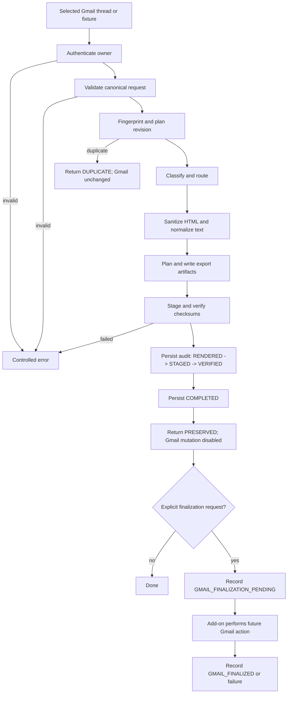

# Problem, Algorithm, Pseudocode, and Flowchart

## Problem

People want a cleaner inbox and a portable copy of important conversations,
but a cleanup action can destroy the only convenient copy. Email content also
contains hostile or remote HTML, attachments need provenance, and retries can
create duplicate exports. The system must make “preserve first, then consider
cleanup” enforceable in code.

## Constraints

- Gmail mutation must remain disabled until explicit post-preservation review.
- A thread, not only the visible message, is the archive unit.
- Export names and paths must be server-controlled and traversal-safe.
- Renderers must receive sanitized content with network access blocked.
- Artifacts must be checksum-verified before completion is recorded.
- Records are owner-scoped and state transitions are auditable.
- The public demo must use synthetic fixtures and avoid secrets.

## Inputs and outputs

**Inputs:** an `ArchiveThreadRequest` containing a `ThreadSnapshot`, owner
identity, preferences, optional signed add-on headers, and optionally trusted
attachment bytes.

**Outputs:** an `ArchiveResult` with status, record reference, verification
summary, and disabled or pending Gmail instructions; local workflows also
produce a package directory and a public-safe review report.

## Algorithm

1. Authenticate the owner and verify the request signature when configured.
2. Validate the canonical thread contract and settings limits.
3. Fingerprint the thread and ask `RevisionPlanner` whether it is duplicate or
   needs a new revision.
4. Classify mail and plan a safe sender-domain/category route.
5. Sanitize HTML and create a renderer-safe snapshot.
6. Plan and write export artifacts.
7. Stage artifacts through the storage boundary and verify checksums.
8. Persist audit states through `COMPLETED`.
9. Return a preservation result with Gmail mutation still disabled.
10. Only in a later explicit handoff, record Gmail finalization pending and then
    record the add-on callback result.

## Pseudocode

```text
function preserve(request, identity, dependencies):
    require identity.email_verified
    validate(request)

    plan = revision_planner.plan(identity.subject, request.thread)
    if plan.status == DUPLICATE:
        return duplicate_result(plan.reference, gmail_enabled=false)

    classification = classify_thread(request.thread)
    route = plan_export_route(request.thread, classification)
    package = plan_export_package(plan.reference, request.thread, route)

    safe_thread = prepare_renderer_safe_thread(request.thread)
    artifacts = write_package(package, request.thread, trusted_attachments)
    verification = stage_and_verify(artifacts)
    require verification.verified

    record_audit(RENDERED, STAGED, VERIFIED)
    record_audit(COMPLETED)

    return preserved_result(
        record=plan.reference,
        verification=verification,
        gmail_finalization_enabled=false,
    )

function request_gmail_finalization(record_id, preferences):
    require latest_state(record_id) in {COMPLETED, CLEAN_INBOX_INTENT_RECORDED}
    record_audit(GMAIL_FINALIZATION_PENDING)
    return instructions(enabled=true)
```

## Mermaid flowchart



## Mapping to the code

| Algorithm step | Implementation |
| --- | --- |
| Identity and request checks | `api/dependencies.py`, `auth/identity.py`, `domain/contracts.py`, `auth/request_signing.py` |
| Duplicate/revision decision | `services/revision_planner.py`, `domain/contracts.py:snapshot_fingerprint` |
| Classification and routing | `services/export_classification.py`, `services/export_routing.py`, `domain/export_package.py` |
| Sanitization and safe rendering | `services/sanitization/html.py`, `services/sanitization/normalize.py`, `services/rendering/snapshot.py`, `services/rendering/pdf.py` |
| Artifact creation and verification | `services/export_writer.py`, `services/rendering/manifest.py`, `services/storage/provider.py` |
| Audit and lifecycle | `services/archive.py`, `repositories/sqlite.py`, `domain/state.py` |
| HTTP boundary | `api/routes.py`, `api/schemas.py` |
| User-facing local workflow | `cli.py`, `api/demo.py` |
| Gmail shell and callback | `services/gmail_addon/Code.gs` |
